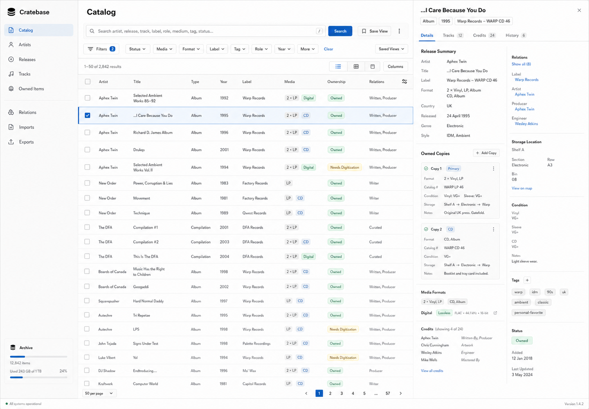
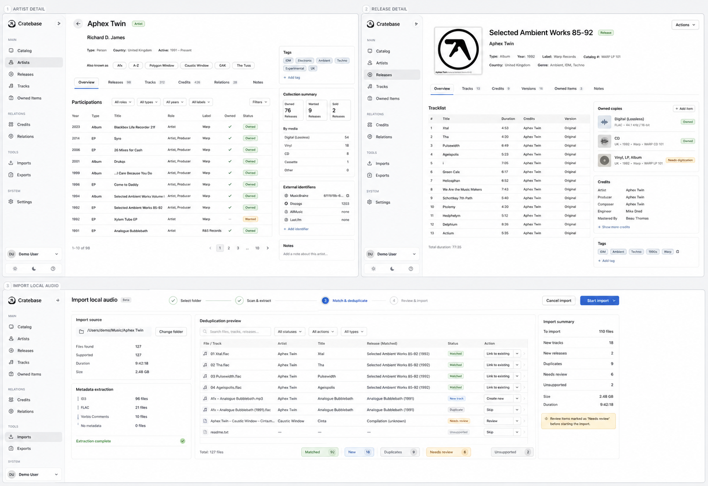

<p align="center">
  
</p>

<p align="center">
  <strong>Your music collection, connected.</strong><br>
  A local-first music catalog for macOS. Keep track of releases, recordings,
  artists, labels, and the copies you own.
</p>

<p align="center">
  <a href="https://github.com/Fredoq/discweave/releases/latest"><strong>Download for Apple Silicon</strong></a>
  · <a href="#try-your-first-import">First import</a>
  · <a href="https://github.com/Fredoq/discweave/discussions">Discussions</a>
  · <a href="https://github.com/Fredoq/discweave/issues">Report an issue</a>
</p>

# DiscWeave

**What do I have in my collection, and how is it connected?**

A folder of audio files tells only part of the story. A track can appear on
several releases. A recording can have edits, remixes, and alternate versions.
An artist can work under aliases or belong to several groups.

DiscWeave helps you keep those connections alongside your digital and physical
collection. It is for collectors, DJs, researchers, and anyone whose music
knowledge has outgrown folders and spreadsheets.

**An archive, not a player.** DiscWeave focuses on cataloging and understanding
music, not streaming or cloud audio storage.

## See the collection, not just the files

| Catalog search and detail                                                                                   | Import review                                                                                              |
| ----------------------------------------------------------------------------------------------------------- | ---------------------------------------------------------------------------------------------------------- |
|  |  |

_These interface previews illustrate the catalog and import workspaces. Details
may differ from the latest release._

## What you can do

- **Build a collection you can search.** Catalog releases, tracks, artists,
  labels, credits, formats, genres, and your own tags.
- **Keep versions connected.** Record aliases, group memberships, credits,
  edits, remixes, and other relationships rather than burying them in notes.
- **Review imports before adding them.** Scan local folders, inspect drafts,
  review duplicate matches and relation suggestions, and use Discogs metadata
  when helpful.
- **Separate the release from your copy.** Track digital files and physical
  items, including condition, storage location, and gaps in your collection.
- **Maintain local files deliberately.** Preview file naming and tag changes;
  keep catalog edits distinct from operations that touch your music files.
- **Take your catalog with you.** Export collection data in human-readable
  formats.
- **Explore beyond your collection.** Optional Discover recommendations use
  your ratings and your own OpenAI API key. Suggestions are checked against
  catalog providers and reviewed before anything is added to Wanted.

## Download and install

**Current packaged target: macOS on Apple Silicon (M-series Macs).** Intel Macs,
Windows, and Linux do not currently have packaged releases.

1. Open the [latest GitHub release](https://github.com/Fredoq/discweave/releases/latest).
2. Download the `DiscWeave-<version>-arm64.dmg` asset. Release assets also include
   `SHA256SUMS.txt` for checking the download.
3. Open the DMG and drag DiscWeave to **Applications**, then launch it from there.

### macOS security notice

Current releases use an **ad-hoc signature**. They are **not signed with an
Apple Developer ID and are not notarized by Apple**. This is the current
no-Apple-Developer-Account distribution path; there is no planned signing date.

macOS may block the first launch because it cannot verify the developer. If you
choose to trust this download, use the per-app **Open Anyway** option in
**System Settings → Privacy & Security** after attempting to open it. Read the
warning before proceeding; this is your decision, not an Apple verification of
the app. Do not disable Gatekeeper globally.

If the app still will not open, please report your macOS version and the exact
warning in an [issue](https://github.com/Fredoq/discweave/issues). Do not include
private collection data or API keys.

## Try your first import

Start with **a copy of one small release folder**, not your whole library.
No DiscWeave account or separately installed server is needed for the packaged
app, and AI is not required for local cataloging.

1. Open **Imports** and select the test folder for a local scan.
2. Open a release draft and check the title, artist, tracklist, and any matching
   suggestions. Files that could not be grouped are available under Loose Files.
3. Review relation suggestions, such as an edit or remix linked to another
   track. Confirm only the matches you understand.
4. Review the confirmation summary and add the release to the catalog.
5. Open **Releases** or **Tracks** to inspect the result and its relationships.

For this first run, leave file-renaming and tag-writing operations unused.
Scanning creates review data; it does not mean every suggestion is correct.
Some metadata will need your judgment.

## Your data and your files

- **Local catalog:** the desktop app runs its own local API and stores its
  SQLite database and artifacts under macOS Application Support. A hosted
  account is not required.
- **Real file operations:** the normal app can rename files, write audio tags,
  and move files to Trash when you explicitly use those actions. It is not a
  read-only sandbox. Back up your music and catalog before bulk changes.
- **Staged edits:** import file edits are applied after catalog confirmation.
  A partial failure does not roll back completed file changes; review the result
  before retrying. See the [local-file workflow](okf/product/local-first-desktop.md).
- **Optional online services:** metadata lookup and discovery contact external
  providers. Discover asks for consent before sending selected rating metadata
  to OpenAI; it does not send your audio files. Your API use may incur provider
  charges. See [Discover privacy and limits](okf/product/discover.md).

## Help shape DiscWeave

The project is actively evolving. A small, concrete report is especially useful:
what you were trying to catalog, what you expected, and where the workflow got
in your way. Use invented or anonymized metadata when sharing examples.

- [Discussions](https://github.com/Fredoq/discweave/discussions) — collection
  workflows, questions, and ideas.
- [Issues](https://github.com/Fredoq/discweave/issues) — reproducible bugs and
  focused feature requests.
- [Roadmap](https://github.com/users/Fredoq/projects/2) — planned work; the
  `Sequence` field describes the intended order, not a delivery promise.
- [Contributing](CONTRIBUTING.md) · [Security](SECURITY.md) ·
  [Code of Conduct](CODE_OF_CONDUCT.md) · [MIT license](LICENSE)

## For developers

The app combines **Electron + React + TypeScript** with an **ASP.NET Core**
sidecar and **SQLite**. The packaged app manages the backend lifecycle locally.

| Directory  | Contents                                                        |
| ---------- | --------------------------------------------------------------- |
| `app/`     | React/Vite UI, Electron shell, and frontend tests               |
| `api/`     | Domain model, persistence, import/export, search, and API tests |
| `okf/`     | Product, domain, architecture, and workflow knowledge           |
| `docs/`    | Release and brand documentation                                 |
| `.github/` | CI, release workflows, and contribution templates               |

Use the .NET SDK specified in [api/global.json](api/global.json) and a Node.js
version supported by [app/package.json](app/package.json).

```sh
# Backend
cd api
dotnet restore DiscWeave.slnx
dotnet build DiscWeave.slnx --configuration Release

# Frontend
cd ../app
npm ci
npm test
npm run build
```

For the complete checks, see [CONTRIBUTING.md](CONTRIBUTING.md).
For the packaged runtime, see the [desktop runtime contract](app/docs/local-desktop-runtime-contract.md)
and [release process](docs/releases/release-process.md).
The [brand guide](docs/brand/identity.md) documents the Woven Catalog Grid identity.
